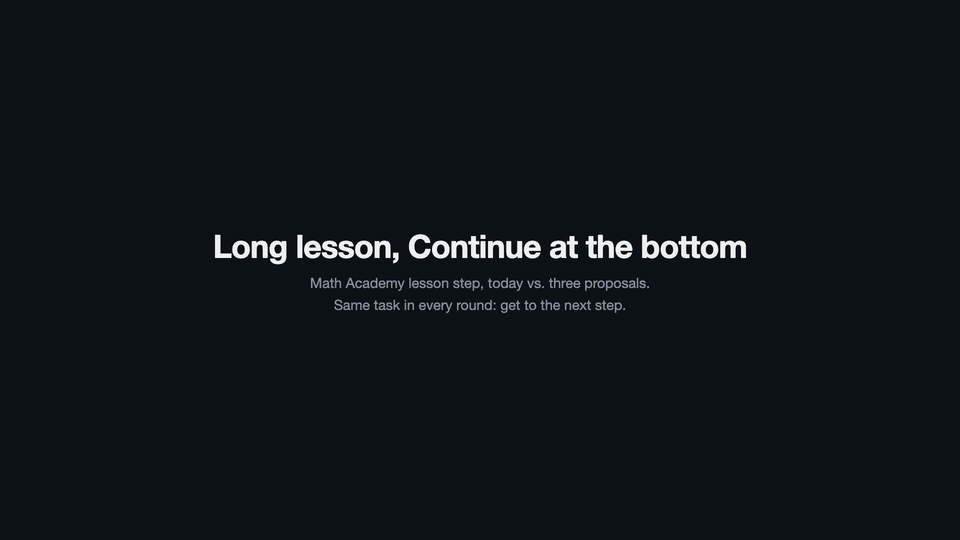

# continue, without the scroll

a prototype for math academy lessons: the continue button sits under the content, so every long step ends with a scroll to find it. three ways to keep it in reach. unofficial.

**[open the prototype](https://maxeozakh.github.io/math-academy-continue/)**

[](https://maxeozakh.github.io/math-academy-continue/video/before-after.mp4)

click the preview for the full film (1080p, 60 fps, no sound).

## the proposals

- **a · in the top bar**: continue sits next to the progress bar, always on screen
- **b · sticky footer**: a fixed bar at the bottom with continue and the step count
- **c · docking button**: continue floats at the bottom while the content overflows and settles under the card when you reach the end; short steps look exactly like today

enter continues in every variant. link straight to one with `?variant=original|top|footer|dock`.

## what's here

- `index.html`: the prototype, static, no build
- `video/`: the film and the scripts that render it frame by frame from the real prototype

## rendering the film

```sh
cd video && npm install
node render.mjs frames 60 7
ffmpeg -y -framerate 60 -i frames/f%05d.png -c:v libx264 -preset slow -crf 16 -pix_fmt yuv420p -movflags +faststart before-after.mp4
```

open `video/film.html?play` over a local server for a real-time preview.
